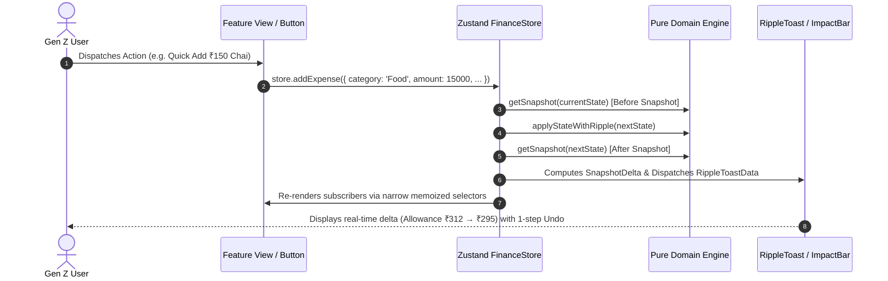

# System Architecture & Clean Domain Boundaries

This document defines the architectural layers, data flow contracts, and mechanical boundary enforcement for **Broke But Functional**.

---

## 1. Architectural Layers & Boundaries

The codebase enforces a strict unidirectional dependency graph verified mechanically in CI via `dependency-cruiser` (`npm run check:arch`).

```mermaid
graph TD
    subgraph UI_Layer [Presentation Layer]
        AppRoutes[Next.js App Router /src/app] --> AppShell[Layout & AppShell /src/components/layout]
        AppShell --> FeatureViews[Feature Views /src/features/*]
        FeatureViews --> UIComponents[Reusable Atoms /src/components/ui]
        FeatureViews --> ChartComponents[Hand-crafted SVG Charts /src/components/charts]
        FeatureViews --> FeedbackComponents[RippleToast & Skeletons /src/components/feedback]
    end

    subgraph State_Layer [State & Persistence Layer]
        FeatureViews --> ZustandStore[Unified FinanceStore /src/store]
        AppShell --> ZustandStore
        ZustandStore --> Persistence[Zod Persistence & Recovery /src/store/persistence]
        ZustandStore --> Selectors[Narrow Pure Selectors /src/store/selectors]
    end

    subgraph Domain_Layer [Pure Domain Engine - Zero UI / Zero Date.now]
        ZustandStore --> DomainEngine[/src/domain/engine/*]
        Selectors --> DomainEngine
        
        DomainEngine --> BalanceCalc[Balance & Settlement]
        DomainEngine --> ObligationsCalc[Commitment & Sub Obligations]
        DomainEngine --> AllowanceCalc[Daily Allowance & Goal Reserve]
        DomainEngine --> ForecastCalc[30-Day Projections & Burn Rate]
        DomainEngine --> RiskCalc[4-Tier Risk Engine]
        DomainEngine --> HealthCalc[6-Factor Health Score]
        DomainEngine --> Simulator[Decision Sandbox Object.freeze]
        DomainEngine --> Seed[Calibrated Demo Seed]
        
        BalanceCalc --> SnapshotModel[Single Snapshot getSnapshot]
        ObligationsCalc --> SnapshotModel
        AllowanceCalc --> SnapshotModel
        ForecastCalc --> SnapshotModel
        RiskCalc --> SnapshotModel
        HealthCalc --> SnapshotModel
    end

    classDef pure fill:#2EE6A6,stroke:#179169,color:#000,stroke-width:2px;
    classDef store fill:#6D4AFF,stroke:#4B2FD1,color:#fff,stroke-width:2px;
    classDef ui fill:#1E1E28,stroke:#444458,color:#fff,stroke-width:1px;
    
    class DomainEngine,BalanceCalc,ObligationsCalc,AllowanceCalc,ForecastCalc,RiskCalc,HealthCalc,Simulator,Seed,SnapshotModel pure;
    class ZustandStore,Persistence,Selectors store;
    class AppRoutes,AppShell,FeatureViews,UIComponents,ChartComponents,FeedbackComponents ui;
```

### Architectural Rules (Enforced via `.dependency-cruiser.cjs`)
1. **Domain Purity (`domain-is-pure`)**: `src/domain` must NEVER import anything from React, Next.js, Zustand, UI components, or features. It consists strictly of pure functions, branded math (`Paise`), and immutable domain models.
2. **Feature Isolation (`features-do-not-cross-import`)**: A feature in `src/features/<featureA>` must NEVER import from `src/features/<featureB>`. Inter-feature communication occurs strictly via the domain model or `useFinanceStore` state/actions.
3. **UI Atom Isolation (`ui-components-do-not-import-features`)**: Reusable atomic primitives in `src/components/ui` (`Button`, `Card`, `Badge`, `Dialog`, `Input`, `Switch`, `Tabs`) must NEVER import domain features.

---

## 2. Unidirectional Data Flow Contract

Every user interaction follows this exact single-direction execution loop:



---

## 3. How to Add a New Feature

To add a new financial capability without violating architecture or regressions:

1. **Define Types & Formulas in Domain (`src/domain/`)**:
   - Add any new entity interface to [`src/domain/types.ts`](file:///c:/Users/Ankit/K/Prompt_run/src/domain/types.ts) with `readonly` properties and branded types.
   - Implement the calculation in a pure function under `src/domain/engine/<feature>.ts`.
   - Write a companion Vitest suite under `tests/domain/<feature>.test.ts` with 100% line and branch coverage.

2. **Integrate into Snapshot (`src/domain/engine/snapshot.ts`)**:
   - Connect the calculation output into `Snapshot` so all application views receive the metric without redundant calculations.

3. **Expose Actions in Store (`src/store/`)**:
   - Add state transitions to [`src/store/stateTransitions.ts`](file:///c:/Users/Ankit/K/Prompt_run/src/store/stateTransitions.ts) and dispatch through `applyStateWithRipple` to preserve the single-step undo contract.

4. **Build Presentational Subcomponents (`src/features/<feature>/`)**:
   - Keep the view orchestrator $\le 120$ lines.
   - Extract cards, dialogs, and tables into `components/` subfolders.
   - Use narrow selectors (`selectBalance`, `selectDailyAllowance`, `selectRisk`) to avoid full-tree re-renders.

5. **Verify Verification Gates**:
   - Run `npm run check:arch` (confirms dependency boundaries).
   - Run `npm run typecheck && npm run lint && npm run test`.
